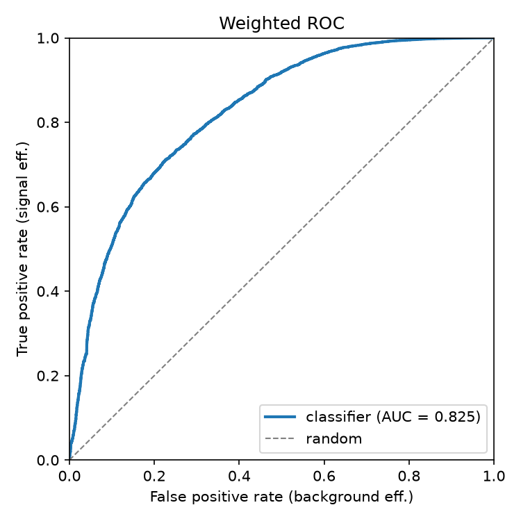
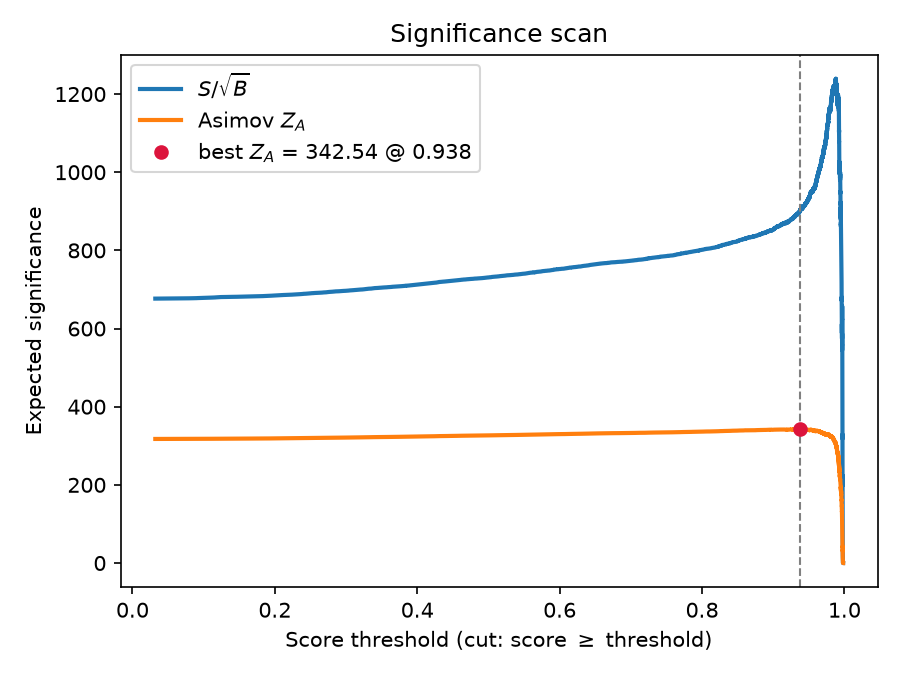
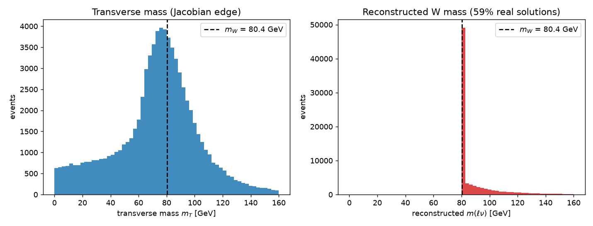
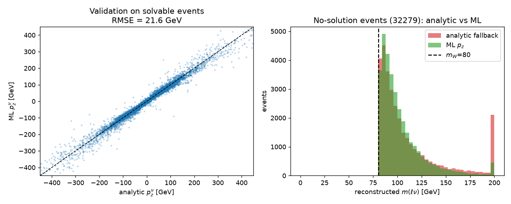
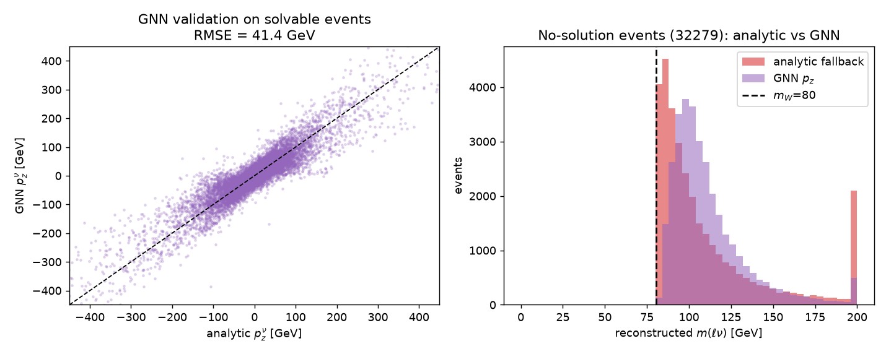

# neutrino-ml

[](https://github.com/raahimnawaz/neutrino-ml/actions/workflows/tests.yml)
[](https://www.python.org/)
[](https://root.cern/)
[](https://opendata.atlas.cern/)
[](LICENSE)

Machine learning for **neutrinos** on real ATLAS Open Data (13 TeV LHC proton–proton
collisions), read from CERN ROOT `TTree`s with `RDataFrame`. A neutrino is invisible — it
escapes as missing energy — so this reconstructs and classifies it the way LHC physicists do.

## The premise: a neutrino is missing energy

A neutrino leaves **no track** in ATLAS — it escapes the detector. Its only signature is an
imbalance in the transverse momentum of the event: **missing transverse energy** (`met_et`,
`met_phi`). So "do ML on neutrinos" means the two things collider physicists actually do:

- **Task A — detect it:** classify events that contain a genuine neutrino (a real `W→ℓν`
  decay) vs backgrounds where the MET is fake or mismeasured.
- **Task B — reconstruct it:** the neutrino's *transverse* momentum **is** the MET; the one
  unmeasured piece is its *longitudinal* momentum `pz`, recovered from the W-mass constraint
  (a quadratic → [`src/physics.py`](src/physics.py) `neutrino_pz`). This is the truest
  "predict the neutrino."

This repo implements Task A end-to-end and provides the Task-B reconstruction physics.

## Data

[ATLAS Open Data 13 TeV](https://opendata.atlas.cern/docs/data/for_education/13TeV_details) —
real 2016 pp collisions + matched MC, ROOT `TTree` named `mini`, ~10 fb⁻¹. Download the
`W→ℓν` signal samples and background samples (Z, ttbar, diboson) into `data/root/`
(gitignored). Key branches (all momenta/energies in **MeV**, converted to GeV on read):

| group | branches |
|---|---|
| lepton | `lep_n, lep_pt, lep_eta, lep_phi, lep_E, lep_type, lep_charge, lep_isTightID, lep_ptcone30, lep_etcone20` |
| neutrino (MET) | `met_et, met_phi` |
| jets | `jet_n, jet_pt, jet_eta, jet_phi, jet_E` |
| weights (MC) | `mcWeight, XSection, SumWeights, scaleFactor_*` |

## Setup

ROOT's Python bindings ship only for Linux/macOS, so on Windows run inside **WSL2** (see the
sibling `anubis-ml` project for the same pattern):

```bash
conda env create -f environment.yml      # ROOT + uproot + xgboost + sklearn + ...
conda activate neutrino-ml
```

## Quickstart

**Real ATLAS data** (auto-downloaded from CERN's public EOS over XRootD, ~60 MB):

```bash
python scripts/download_data.py   # reduced W dataset -> data/root/{mc,data}/  (skips existing)
python -m src.pipeline            # Task A: classify W->l nu vs background (uses real data if present)
python -m src.task_b_reco         # Task B: reconstruct the neutrino pz + W mass  -> results/wmass_reco.png
python -m src.task_b_regression   # Task B stretch: tabular ML neutrino-pz regressor
python -m src.gnn_taskA           # Task A rep-3: event-graph GNN classifier
python -m src.gnn_taskB           # Task B: event-graph GNN neutrino-pz regressor (topological)
```

**No download needed** — the whole pipeline is also proven on a **synthetic** ntuple:

```bash
python tests/make_sample.py       # data/root/sample_{signal,bkg}.root (uproot, MeV units)
python -m src.pipeline            # falls back to the synthetic fixtures automatically
pytest tests/                     # physics unit tests (pure numpy, no ROOT)
```

### Results on real data (10 fb⁻¹)

| | |
|---|---|
| events selected | 78,958 W→ℓν signal / 36,231 background |
| Task A — weighted AUC | **XGBoost 0.825**, logistic-regression 0.733, event-GNN 0.781 |
| Task B — reconstructed W mass | **median 80.38 GeV** (PDG: 80.379), 59% with a real ν-pz solution |

**Three representations of the same events** (the project's core comparison): engineered
features → XGBoost (0.825) ≳ logistic regression (0.733); particle-level object graph →
GNN (0.781, `src/gnn_taskA.py`). The GNN learns straight from the objects with no hand-crafted
summary, but on this ~2–6-object final state it doesn't beat gradient boosting — the expected
"trees win on low-dimensional structured data" result, and an honest representation comparison.

**Task A — classifier performance** (weighted, real data): ROC and the significance scan.




**Task B — the neutrino, reconstructed.** Left: the W transverse-mass Jacobian edge at `m_W`.
Right: the full reconstructed W mass peaks sharply at 80.4 GeV once the neutrino `pz` is solved.



Real NLO MC (Sherpa W+jets) contains ~14% **negative-weight events** — a genuine generator
feature. The classifiers train on `|w|` (standard HEP practice); the significance keeps the
signed weights, where negative events physically subtract. See `src/models.py`.

### Task B stretch — ML neutrino-pz regression (`src/task_b_regression.py`)

The analytic reconstruction has no real solution for ~41% of events. An XGBoost regressor,
trained on the analytic `pz` of the *solvable* events (no truth-level `pz` exists in the
data — verified), **reproduces the physics-correct `pz` on held-out solvable events with
RMSE 21.6 GeV (R² ≈ 0.96)**. But it does *not* rescue the unsolvable 41% — and the reason is
the point: those events have **mT > mW** (100% of them, verified), so `m(ℓν) ≥ mT > mW` for
*any* `pz`. No method can reconstruct them to the W peak; it's a hard kinematic floor, not a
model limitation. The ML still gives a more physical `pz` everywhere (it removes the analytic
fallback's pathological high-mass tail), useful for building the full neutrino 4-vector — but
it can't beat physics. (Same lesson as the data-selection traps: verify what's *possible*
before trying to model it.)

**Three ways to predict where the neutrino is** (`pz`):

| method | RMSE vs analytic `pz` | notes |
|---|---|---|
| analytic W-mass quadratic | — (exact where it exists) | no real solution for 41% (mT > mW) |
| tabular XGBoost regressor (`task_b_regression.py`) | **21.6 GeV** | best; sees lepton kinematics directly |
| event-graph GNN regressor (`gnn_taskB.py`) | 41.4 GeV | "topological" / geometric deep learning |

The GNN — geometric deep learning on the event's object-graph — is the honest "topological
method" for this problem, but it comes **last**: `pz` depends critically on the lepton's
longitudinal momentum (one node), and the GNN's mean-pooling over ~4 nodes blurs exactly that.
On a low-object-count final state, the direct/tabular model wins. A legitimate, measured result
— matching the Task A finding that the event-GNN classifier (0.781) also trailed XGBoost (0.825).

Left panels: predicted vs analytic `pz` on held-out solvable events. Right panels: the ~41%
no-solution events (the analytic method's real-part fallback vs the ML `pz`).




## Pipeline

```
ROOT ntuple                       src/read_root.py    RDataFrame -> GeV arrays
   │
   ▼  W→ℓν selection              src/selection.py    1 tight isolated lepton, met>30, cutflow
   ▼  physical event weights      src/weights.py      mcWeight·SF·(XSection·lumi/SumWeights)
   ▼  engineered features         src/features.py     mt, dphi(ℓ,MET), HT, isolation, ...
   ▼  labelled dataset            src/dataset.py      -> data/processed/dataset.parquet
   ▼  models                      src/models.py       XGBoost + logistic-regression baseline
   ▼  physics evaluation          src/evaluation.py   weighted ROC/AUC, S/√B + Asimov Z, SIC
```

Everything is **weighted** — the split, the AUC, the significance — using the real MC event
weights. That weighting is the single most important thing separating a HEP analysis from a
generic classifier.

## Repo layout

```
src/
  physics.py       pure-numpy kinematics: transverse_mass, delta_phi, neutrino_pz (W-mass reco)
  read_root.py     RDataFrame reader (MeV -> GeV)
  selection.py     W→ℓν cuts + cutflow
  weights.py       physical MC event weights
  features.py      per-event feature table
  dataset.py       read+select+weight+featurize -> parquet
  models.py        XGBoost + logistic-regression (train on |w| for negative NLO weights)
  evaluation.py    weighted AUC, significance scan, SIC, plots, W-mass reconstruction
  pipeline.py      Task A end-to-end runner (python -m src.pipeline)
  task_b_reco.py   Task B: neutrino-pz + W-mass reconstruction (python -m src.task_b_reco)
  task_b_regression.py  Task B stretch: ML neutrino-pz regressor
  gnn_taskA.py     Task A representation 3: event-graph GNN classifier
  gnn_taskB.py     Task B: event-graph GNN neutrino-pz regressor (topological/geometric DL)
scripts/
  samples.json     ATLAS Open Data process -> file mapping (signal=wjets, bkg=others)
  download_data.py XRootD downloader for the reduced W dataset
tests/
  test_physics.py  unit tests for the kinematics (run in CI, no ROOT)
  make_sample.py   synthetic ntuple generator for the smoke test
config.yaml        selection cuts, luminosity, feature list, signal/background categories
```

## What's real vs simplified

**Real ATLAS methods here:** `RDataFrame` selection, physically-motivated features, the
transverse-mass handle, weighted significance (`S/√B` and the Asimov `Z`), ML-vs-baseline
comparison, and the neutrino-`pz` W-mass reconstruction.

**Simplified vs a publication:** no systematic uncertainties, no data-driven background
estimation (control regions), no profile-likelihood fit, and no blinding. Those are the bulk
of a real analysis — this is a faithful *miniature* of the workflow, not a stand-in for it.
