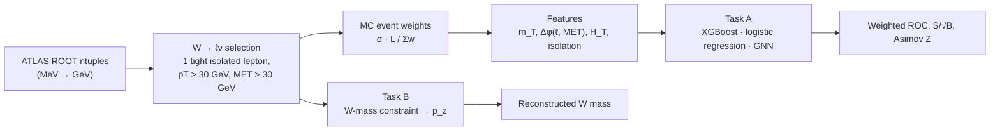

# neutrino-ml

[](https://github.com/raahimnawaz/neutrino-ml/actions/workflows/tests.yml)
[](https://www.python.org/)
[](https://root.cern/)
[](https://opendata.atlas.cern/)
[](LICENSE)

Detecting and reconstructing neutrinos in real LHC collisions, using ATLAS Open Data (13 TeV, 10 fb⁻¹) read from CERN ROOT files with `RDataFrame`.

A neutrino leaves no track. Its only trace is an imbalance in the event's transverse momentum, the missing transverse energy (MET). This project does the two things collider physicists do with that:

- **Task A, detect it:** separate real `W → ℓν` decays from backgrounds where the MET is fake or mismeasured.
- **Task B, reconstruct it:** recover the neutrino's longitudinal momentum `p_z`, the one component the detector can't measure.


## Results

78,958 signal and 36,231 background events pass the selection.

| | Result |
|---|---|
| Task A: weighted ROC AUC | **XGBoost 0.825**, event-graph GNN 0.781, logistic regression 0.733 |
| Task B: reconstructed W mass | **median 80.38 GeV** against the PDG value of 80.379 |
| Task B: events with a real `p_z` solution | 59 % |
| Task B: ML `p_z` regression | RMSE 21.6 GeV (R² ≈ 0.96) for XGBoost, 41.4 GeV for a GNN |

- **Trees beat graphs here.** Each event has only 2–6 physics objects, so engineered features plus gradient boosting win, both for classification and for `p_z`. The GNN pools over a handful of nodes and blurs the lepton's `p_z`, the one input that matters most.
- **41 % of events can't be reconstructed by any method,** and the reason is kinematic, not a model limit (below).

## How it works



**Every number is weighted.** Each simulated event carries `mcWeight × scale factors × σ · L / Σw`, so the weighted counts match what 10 fb⁻¹ of collisions would produce. The train/test split, the AUC and the significance all use those weights. About 14 % of the NLO W+jets events have negative weights; models train on `|w|`, while the significance keeps the sign.

**The strongest single feature** is the transverse mass of the lepton–neutrino system:

```
m_T = √( 2 · p_T^ℓ · MET · (1 − cos Δφ) )
```

For a real W decay it has a sharp edge at `m_W`.

**Reconstructing `p_z`.** Treating the lepton and neutrino as massless and requiring `(p_ℓ + p_ν)² = m_W²`, with the neutrino's transverse momentum set to the MET, gives a quadratic in `p_z^ν`:

```
μ     = m_W²/2 + p_T^ℓ · p_T^ν          (transverse dot product)
p_z^ν = ( μ · p_z^ℓ ± √Δ ) / (p_T^ℓ)²
Δ     = (E^ℓ)² · ( μ² − (p_T^ℓ)² (p_T^ν)² )
```

The analysis keeps the root with the smaller `|p_z|`. Since `μ − p_T^ℓ p_T^ν = (m_W² − m_T²)/2`, a real solution exists exactly when `m_T ≤ m_W`. Every unsolvable event in the data has `m_T > m_W`, so its invariant mass is at least `m_T > m_W` for any `p_z`. No method can put those events on the W peak.

## Quickstart

```bash
conda env create -f environment.yml && conda activate neutrino-ml

python scripts/download_data.py   # reduced W dataset from CERN's public EOS, about 60 MB
python -m src.pipeline            # Task A
python -m src.task_b_reco         # Task B: analytic p_z and the W mass
python -m src.task_b_regression   # Task B: ML p_z regressor
python -m src.gnn_taskA           # Task A: event-graph GNN
python -m src.gnn_taskB           # Task B: event-graph GNN
```

No download needed for a first run: `python tests/make_sample.py` writes a synthetic ntuple that the pipeline falls back to, and `pytest tests/` runs the physics tests without ROOT. ROOT's Python bindings are Linux and macOS only, so use WSL2 on Windows.

## Limitations

This is a faithful miniature of an ATLAS analysis, not a publication-grade one. It has no systematic uncertainties, no data-driven background estimates from control regions, no profile-likelihood fit and no blinding, which together make up most of a real analysis.

## More detail

- [docs/details.md](docs/details.md): the dataset and branches, the pipeline stage by stage, negative weights, the three `p_z` methods compared, and a map of the code
- [config.yaml](config.yaml): selection cuts, luminosity, features and sample categories
