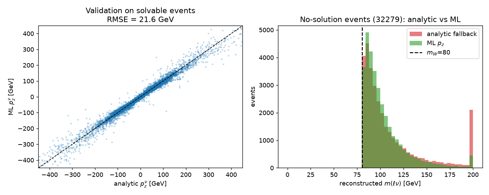
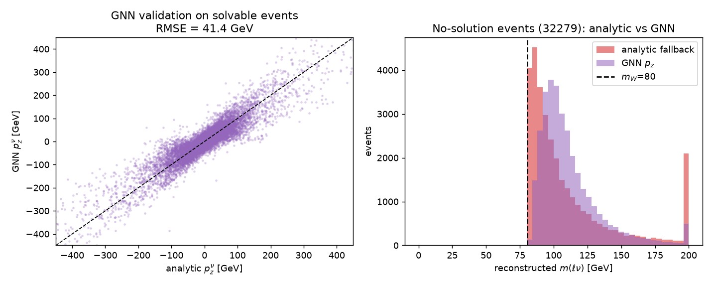

# Details

The full write-up behind the [README](../README.md): the dataset and its branches, how the
selection and weights work, the three methods for the neutrino's `pz`, and a map of the code.

## Data

[ATLAS Open Data 13 TeV](https://opendata.atlas.cern/docs/data/for_education/13TeV_details) —
real 2016 pp collisions + matched MC, ROOT `TTree` named `mini`, ~10 fb⁻¹. Download the
`W→ℓν` signal samples and background samples (Z, ttbar, diboson) into `data/root/`
(gitignored). Key branches (all momenta/energies in **MeV**, converted to GeV on read):

| group | branches |
|---|---|
| lepton | `lep_n, lep_pt, lep_eta, lep_phi, lep_E, lep_type, lep_charge, lep_isTightID, lep_ptcone30, lep_etcone20` |
| neutrino (MET) | `met_et, met_phi` |
| jets | `jet_n, jet_pt, jet_eta, jet_phi, jet_E` |
| weights (MC) | `mcWeight, XSection, SumWeights, scaleFactor_*` |

## Pipeline

```
ROOT ntuple                       src/read_root.py    RDataFrame -> GeV arrays
   │
   ▼  W→ℓν selection              src/selection.py    1 tight isolated lepton, met>30, cutflow
   ▼  physical event weights      src/weights.py      mcWeight·SF·(XSection·lumi/SumWeights)
   ▼  engineered features         src/features.py     mt, dphi(ℓ,MET), HT, isolation, ...
   ▼  labelled dataset            src/dataset.py      -> data/processed/dataset.parquet
   ▼  models                      src/models.py       XGBoost + logistic-regression baseline
   ▼  physics evaluation          src/evaluation.py   weighted ROC/AUC, S/√B + Asimov Z, SIC
```

Everything is **weighted** — the split, the AUC, the significance — using the real MC event
weights. That weighting is the single most important thing separating a HEP analysis from a
generic classifier.

## Negative event weights

Real NLO MC (Sherpa W+jets) contains ~14% **negative-weight events** — a genuine generator
feature. The classifiers train on `|w|` (standard HEP practice); the significance keeps the
signed weights, where negative events physically subtract. See `src/models.py`.

## Task B in detail: predicting the neutrino `pz` with ML (`src/task_b_regression.py`)

The analytic reconstruction has no real solution for ~41% of events. An XGBoost regressor,
trained on the analytic `pz` of the *solvable* events (no truth-level `pz` exists in the
data — verified), **reproduces the physics-correct `pz` on held-out solvable events with
RMSE 21.6 GeV (R² ≈ 0.96)**. But it does *not* rescue the unsolvable 41% — and the reason is
the point: those events have **mT > mW** (100% of them, verified), so `m(ℓν) ≥ mT > mW` for
*any* `pz`. No method can reconstruct them to the W peak; it's a hard kinematic floor, not a
model limitation. The ML still gives a more physical `pz` everywhere (it removes the analytic
fallback's pathological high-mass tail), useful for building the full neutrino 4-vector — but
it can't beat physics. (Same lesson as the data-selection traps: verify what's *possible*
before trying to model it.)

**Three ways to predict where the neutrino is** (`pz`):

| method | RMSE vs analytic `pz` | notes |
|---|---|---|
| analytic W-mass quadratic | — (exact where it exists) | no real solution for 41% (mT > mW) |
| tabular XGBoost regressor (`task_b_regression.py`) | **21.6 GeV** | best; sees lepton kinematics directly |
| event-graph GNN regressor (`gnn_taskB.py`) | 41.4 GeV | "topological" / geometric deep learning |

The GNN — geometric deep learning on the event's object-graph — is the honest "topological
method" for this problem, but it comes **last**: `pz` depends critically on the lepton's
longitudinal momentum (one node), and the GNN's mean-pooling over ~4 nodes blurs exactly that.
On a low-object-count final state, the direct/tabular model wins. A legitimate, measured result
— matching the Task A finding that the event-GNN classifier (0.781) also trailed XGBoost (0.825).

Left panels: predicted vs analytic `pz` on held-out solvable events. Right panels: the ~41%
no-solution events (the analytic method's real-part fallback vs the ML `pz`).




## Repo layout

```
src/
  physics.py       pure-numpy kinematics: transverse_mass, delta_phi, neutrino_pz (W-mass reco)
  read_root.py     RDataFrame reader (MeV -> GeV)
  selection.py     W→ℓν cuts + cutflow
  weights.py       physical MC event weights
  features.py      per-event feature table
  dataset.py       read+select+weight+featurize -> parquet
  models.py        XGBoost + logistic-regression (train on |w| for negative NLO weights)
  evaluation.py    weighted AUC, significance scan, SIC, plots, W-mass reconstruction
  pipeline.py      Task A end-to-end runner (python -m src.pipeline)
  task_b_reco.py   Task B: neutrino-pz + W-mass reconstruction (python -m src.task_b_reco)
  task_b_regression.py  Task B stretch: ML neutrino-pz regressor
  gnn_taskA.py     Task A representation 3: event-graph GNN classifier
  gnn_taskB.py     Task B: event-graph GNN neutrino-pz regressor (topological/geometric DL)
scripts/
  samples.json     ATLAS Open Data process -> file mapping (signal=wjets, bkg=others)
  download_data.py XRootD downloader for the reduced W dataset
tests/
  test_physics.py  unit tests for the kinematics (run in CI, no ROOT)
  make_sample.py   synthetic ntuple generator for the smoke test
config.yaml        selection cuts, luminosity, feature list, signal/background categories
```
